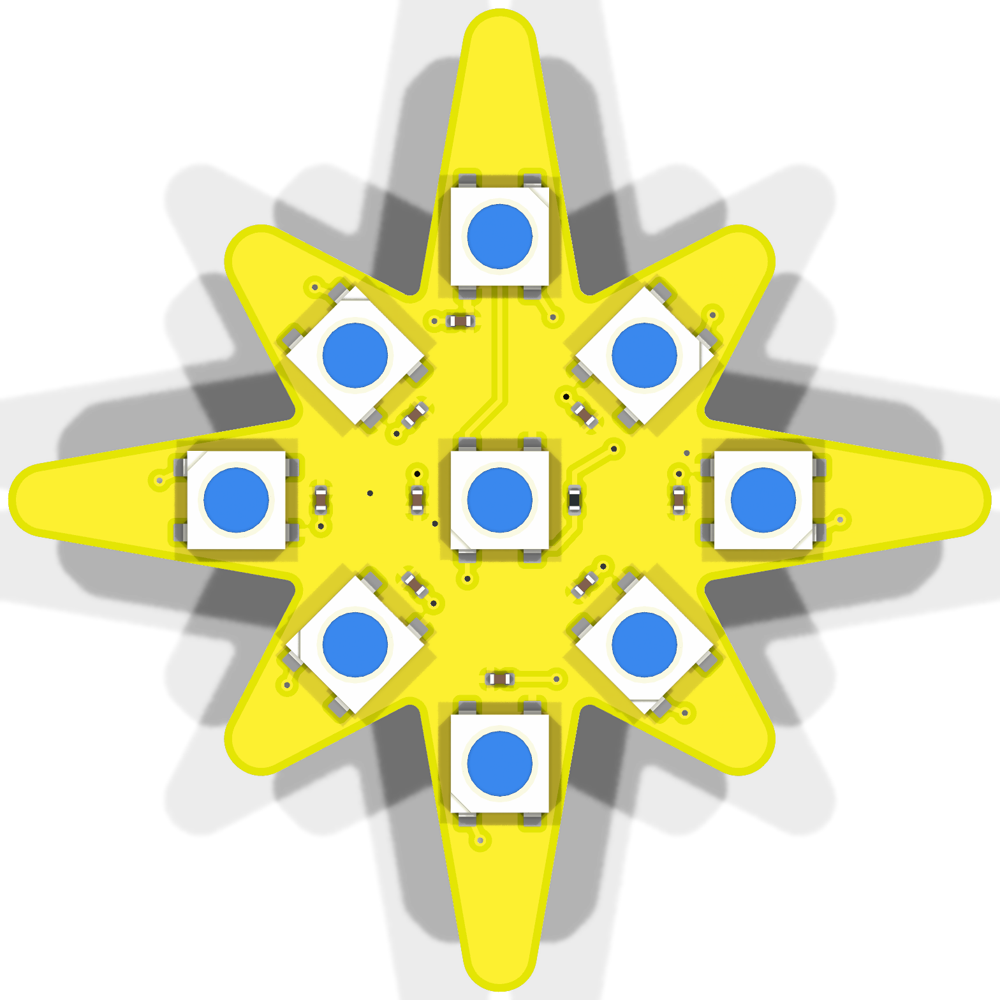
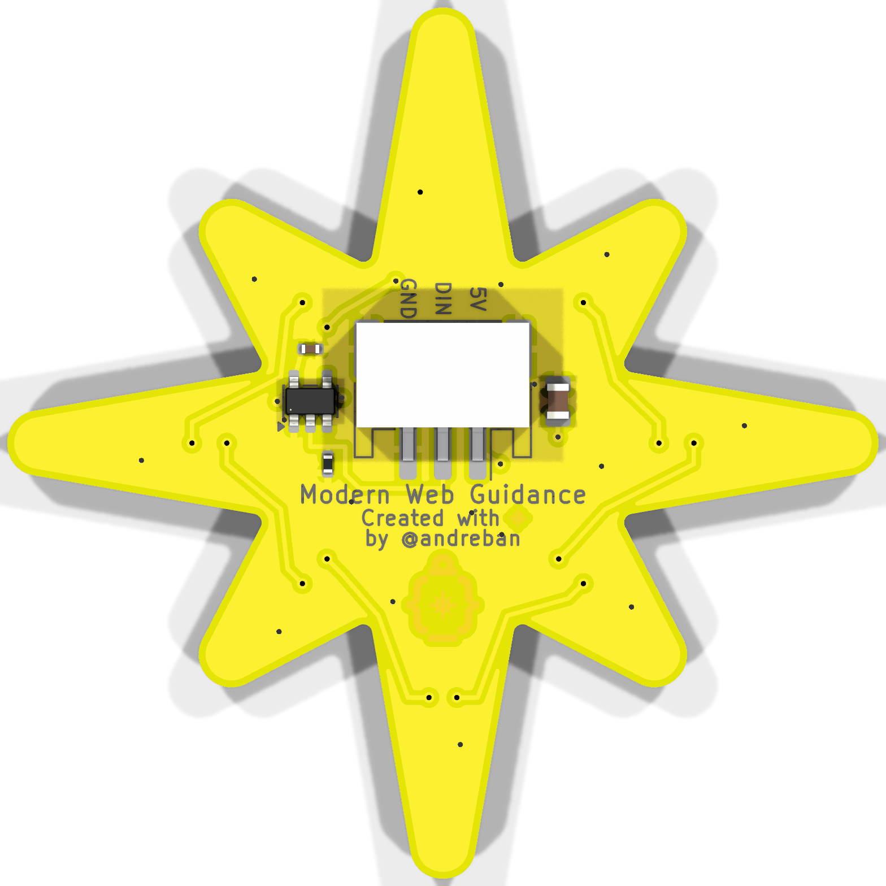
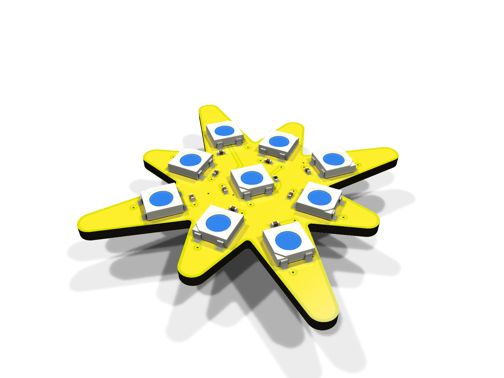
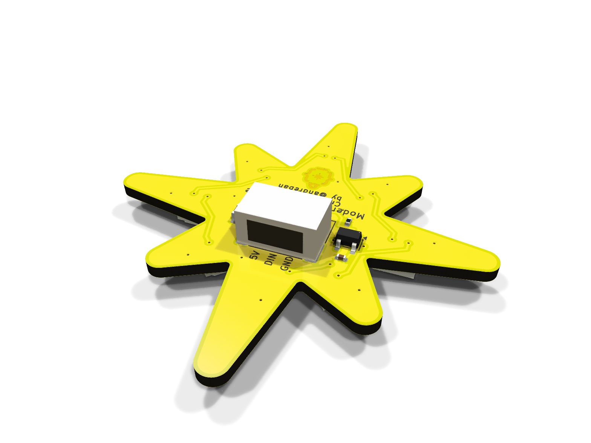

# NeoPixel Star

A 50 mm, star-shaped NeoPixel board in the spirit of the Adafruit Jewel. The outline is the exact
yellow sparkle from the [Modern Web Guidance logo](reference/mwg-logo.svg), uniformly scaled.

| Front | Back |
|---|---|
|  |  |
|  |  |

- 9 × WS2812B (5050): one in the centre, one in each of the 8 points
- 100 nF decoupling cap per LED, 10 µF bulk cap
- On-board **74AHCT1G125 level shifter**, so 3.3 V microcontrollers (Pico, ESP32, …) drive it reliably
- JST-PH 2.0 mm 3-pin connector on the back, cable exits toward the top point
- Yellow solder mask, black silkscreen, ENIG, with the MWG logo in exposed gold on the back
- 2 layers, 1.6 mm. Front is a solid 5 V pour, back a solid GND pour

Schematic: [docs/schematic.pdf](docs/schematic.pdf)

## Wiring

| J1 pin | Signal | Connect to |
|---|---|---|
| 1 | 5V | MCU board's 5 V / VBUS / USB pin, or an external 5 V supply |
| 2 | DIN | Any GPIO (3.3 V or 5 V logic) |
| 3 | GND | GND |

Pins are labelled on the back, next to the connector. The data chain is: LED1 in the centre,
then the top point, then clockwise (index 0 = centre, 1 = top, 2 = top-right, … 8 = top-left).

**Power:** at full white the board draws about 540 mA, which is more than many USB ports and cables
supply. When powering from the MCU's USB 5 V pin, cap the brightness in software:

```cpp
strip.setBrightness(80);                        // Adafruit_NeoPixel, 0-255
FastLED.setMaxPowerInVoltsAndMilliamps(5, 400); // FastLED
```

Don't power it from a 3V3 pin. The LEDs need 3.7–5.3 V, and a 3.3 V regulator can't supply the current.

## Ordering

The Gerbers are shared by both fabs. Silkscreen colour is an order option, not part of the files.

**Board options (both fabs):** 2 layers · 1.6 mm FR-4 · **yellow** solder mask · **black** silkscreen ·
**ENIG** surface finish (this is what makes the logo gold) · 1 oz copper.

### JLCPCB

1. Upload `fab/neopixel-star-gerbers.zip`.
2. Choose the options above. If black silkscreen isn't offered with yellow mask, white is the fallback.
   Set *Mark on PCB* to *Remove Mark* (or you get an order number printed on the board).
3. PCB Assembly: **both sides**. Upload `fab/jlcpcb/bom.csv` and `fab/jlcpcb/cpl.csv`.
4. **Check part rotations in JLCPCB's placement preview**, especially the LEDs, U1 and J1.
   KiCad's and JLCPCB's zero orientations don't always agree. Fix any that are off in the
   preview. Pin 1 of each LED should match the notched corner in the preview.

### PCBWay

1. Upload `fab/neopixel-star-gerbers.zip` and choose the options above (black silkscreen on yellow mask).
2. For assembly, upload `fab/pcbway/bom.csv` (manufacturer part numbers, LCSC numbers included
   as a cross-reference) and `fab/pcbway/centroid.csv`. Components are on both sides.

### Parts

| Ref | Part | LCSC |
|---|---|---|
| LED1–LED9 | Worldsemi WS2812B-B/T, 5050 | C2761795 |
| C1–C9, C11 | 100 nF 0402 X7R (Samsung CL05B104KO5NNNC) | C1525 |
| C10 | 10 µF 0805 X5R (Samsung CL21A106KAYNNNC) | C15850 |
| R1 | 330 Ω 0402 (UNI-ROYAL 0402WGF3300TCE) | C25104 |
| R2 | 100 kΩ 0402 (UNI-ROYAL 0402WGF1003TCE) | C25741 |
| U1 | TI SN74AHCT1G125DBVR, SOT-23-5 | C7484 |
| J1 | JST S3B-PH-SM4-TB(LF)(SN) | C265101 |

Check stock and prices when ordering. Any WS2812B/SK6812 in the 4-pin 5050 package with the
same pinout works.

## Opening in KiCad or EasyEDA

- **KiCad 10:** open `kicad/neopixel-star.kicad_pro`. Symbols and footprints come from the project's
  own libraries (`neopixel-star.kicad_sym`, `neopixel-star.pretty`), so no global libraries are needed.
  KiCad ships no 3D model for the SMD JST connector. `neopixel-star.3dshapes/` has a simple generated
  one (housing, opening, leads, tabs), used for the renders.
- **EasyEDA Pro:** *File → Import → KiCad*, then pick `easyeda/neopixel-star-kicad.zip`.
  EasyEDA rebuilds copper pours on import, so check the two pours after importing.
  The files are in KiCad 10 format. EasyEDA's docs only promise KiCad 5.x and later, and newer
  versions aren't documented. If the import fails, open the project in KiCad and use
  *File → Archive Project*, or fall back to `easyeda/outline.dxf` (exact board outline) plus the Gerbers.

## Rebuilding

Everything is generated by scripts from [scripts/parts.py](scripts/parts.py) and
[scripts/config.py](scripts/config.py). KiCad 10 must be installed (the path is set in `config.py`).

```sh
python scripts/build_all.py
```

This regenerates the schematic and board, refills the pours with KiCad's zone filler, and runs ERC
and DRC with schematic parity. The build stops on any violation. It then exports Gerbers, the
JLCPCB/PCBWay BOM and placement files, the EasyEDA package and the renders in `docs/`.

To change the size, edit `STAR_WIDTH` in `config.py`. Below about 44.5 mm the 5050 LEDs no longer
fit in the points. The LED radii, routing waypoints and back-side layout are tuned for 50 mm, so
check DRC after changing it.
