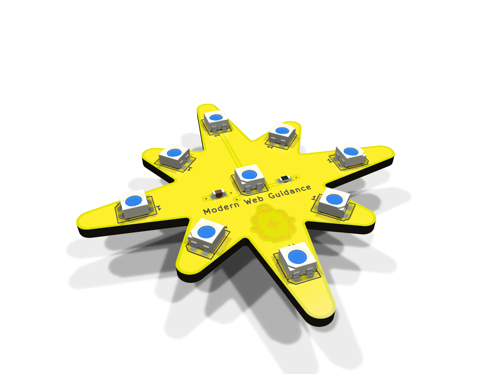
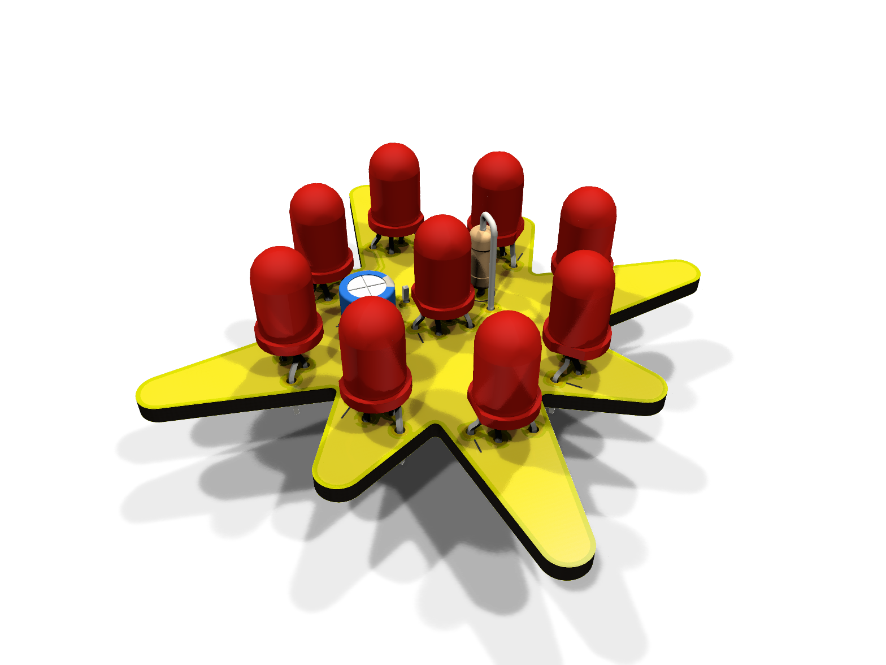

# NeoPixel Star

A star-shaped NeoPixel board in the spirit of the Adafruit Jewel. The outline is the exact yellow
sparkle from the [Modern Web Guidance logo](reference/mwg-logo.svg), uniformly scaled. Nine
addressable RGB LEDs: one in the centre, one in each of the 8 points.

| SMD ([smd/](smd/README.md)) | Hot-plate ([hotplate/](hotplate/README.md): [v1](hotplate/v1/README.md) / [v2](hotplate/v2/README.md)) | Through-hole ([tht/](tht/README.md)) |
|---|---|---|
|  |  |  |
| 50 mm · 9 × WS2812B (5050) | 50 mm · 9 × WS2812B-Mini (3535) | 55 mm · 9 × WS2812D-F5 (5 mm) |
| Fab-assembled, parts on both sides | Front reflowed on a hot plate, back soldered by iron | Hand-soldered |
| 74AHCT1G125 level shifter, 100 nF per LED | 0603 passives; [v1](hotplate/v1/README.md) with level shifter, [v2](hotplate/v2/README.md) direct 3.3 V data | LEDs take 3.3 V data directly |

All versions share:

- A JST-PH 2.0 mm 3-pin connector on the back, cable toward the top point, pins labelled `5V / DIN / GND`
- Yellow solder mask, black silkscreen, ENIG, with the MWG logo in exposed gold on the back
- 2 layers, 1.6 mm. Front is a solid 5 V pour, back a solid GND pour
- The same data order, so the same code drives any of them

> **Status:** all designs pass KiCad ERC and DRC, including a check that each board matches its
> schematic. None has been manufactured or tested yet. Treat the first order as a prototype run.

## Wiring

| J1 pin | Signal | Connect to |
|---|---|---|
| 1 | 5V | MCU board's 5 V / VBUS / USB pin, or an external 5 V supply |
| 2 | DIN | Any GPIO (3.3 V or 5 V logic) |
| 3 | GND | GND |

The data chain is: LED1 in the centre, then the top point, then clockwise (index 0 = centre,
1 = top, 2 = top-right, … 8 = top-left).

Minimal Arduino sketch ([Adafruit NeoPixel](https://github.com/adafruit/Adafruit_NeoPixel)):

```cpp
#include <Adafruit_NeoPixel.h>

Adafruit_NeoPixel star(9, /* DIN pin */ 6, NEO_GRB + NEO_KHZ800);

void setup() {
  star.begin();
  star.setBrightness(80);  // keep USB-powered boards within budget, see below
}

void loop() {
  for (int i = 0; i < 9; i++) {          // light each LED in turn, centre first
    star.clear();
    star.setPixelColor(i, star.Color(255, 180, 0));
    star.show();
    delay(200);
  }
}
```

**Power:** at full white each board draws about 540 mA, which is more than many USB ports and
cables supply. When powering from the MCU's USB 5 V pin, cap the brightness in software:

```cpp
strip.setBrightness(80);                        // Adafruit_NeoPixel, 0-255
FastLED.setMaxPowerInVoltsAndMilliamps(5, 400); // FastLED
```

Don't power it from a 3V3 pin. The LEDs need 3.7–5.3 V, and a 3.3 V regulator can't supply the current.

## Ordering

Each version has its own Gerbers in `<version>/fab/`, which work at both JLCPCB and PCBWay.
Silkscreen colour is an order option, not part of the files.

**Board options:** 2 layers · 1.6 mm FR-4 · **yellow** solder mask · **black** silkscreen ·
**ENIG** surface finish (this is what makes the logo gold) · 1 oz copper.

Version-specific steps, BOM and placement files: [SMD](smd/README.md#ordering) ·
[hot-plate v1](hotplate/v1/README.md#ordering) / [v2](hotplate/v2/README.md#ordering) · [through-hole](tht/README.md#ordering).

## Opening in KiCad or EasyEDA

Each version is a self-contained KiCad 10 project in `<version>/kicad/`. Its symbols and footprints
come from the project's own libraries, so no global libraries are needed. `<version>/easyeda/` has
the project zipped for EasyEDA Pro (*File → Import → KiCad*) and the exact outline as DXF. See the
[SMD notes](smd/README.md#opening-in-kicad-or-easyeda) for EasyEDA's via rule and expected warnings.

## Repository layout

| Path | Contents |
|---|---|
| `smd/`, `hotplate/v1/`, `hotplate/v2/`, `tht/` | One folder per version: `README.md`, `kicad/` (project and libraries), `fab/` (Gerbers, BOM, placement), `easyeda/`, `docs/` (renders, assembly drawings, schematic PDF) |
| `scripts/` | Generators: everything in the version folders except the READMEs is built from these |
| `scripts/common/` | Code shared by all versions: outline, logo, design rules, board and schematic helpers |
| `scripts/smd/`, `scripts/hotplate/v1/`, `scripts/hotplate/v2/`, `scripts/tht/` | Per version: `parts.py` (parts and nets), `layout.py` (placement and routing), `schematic.py` |
| `reference/` | The source logo SVG |
| `PLAN.md` | Design decisions and their reasoning |
| `AGENTS.md` | How to change the design (for AI agents and humans) |

## Rebuilding

KiCad 10 must be installed. It is found in its standard install location, or set `KICAD_DIR` to the
installation directory.

```sh
python scripts/build_all.py          # all versions
python scripts/build_all.py tht      # one version: smd, hotplate, hotplate/v1, hotplate/v2 or tht
```

For each version, this regenerates the schematic and board, refills the pours with KiCad's zone
filler, and runs ERC and DRC with schematic parity. The build stops on any violation. It then
exports the Gerbers, the JLCPCB/PCBWay BOM and placement files, the EasyEDA package, the renders and
the assembly drawings (SVG, plus a printable PDF).

## Credits

The board outline and back-side artwork use the Modern Web Guidance logo from
[developer.chrome.com](https://developer.chrome.com/). Inspired by the
[Adafruit NeoPixel Jewel](https://www.adafruit.com/product/2226).

## License

[Apache License 2.0](LICENSE).
