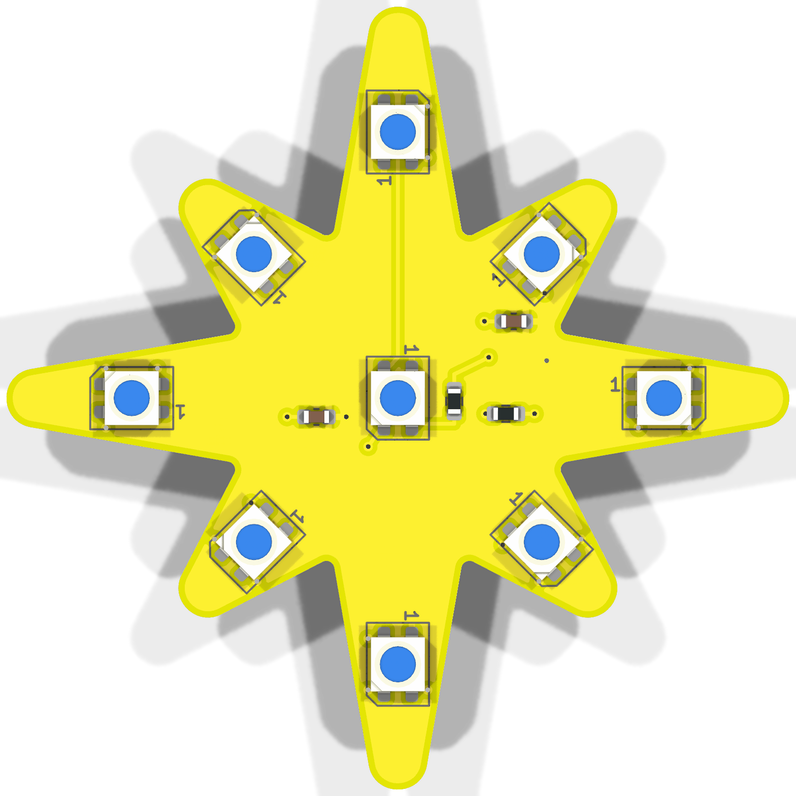
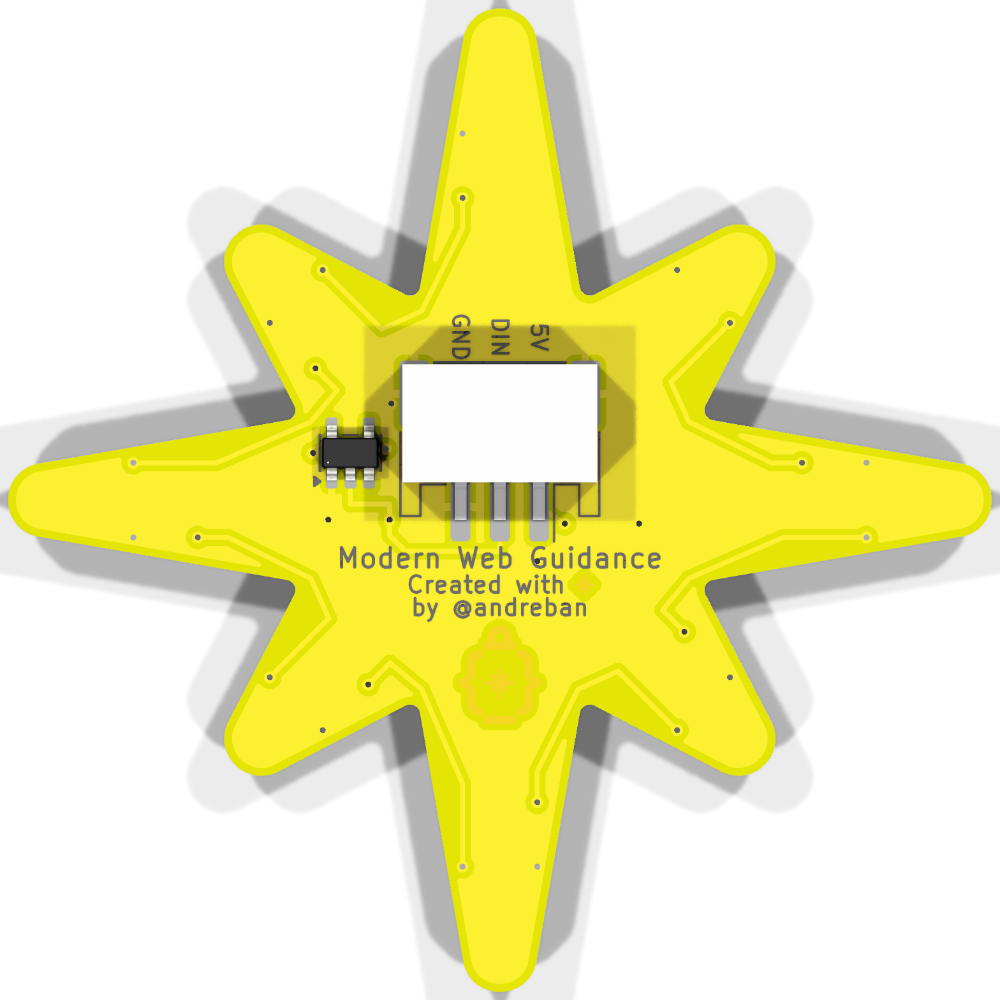
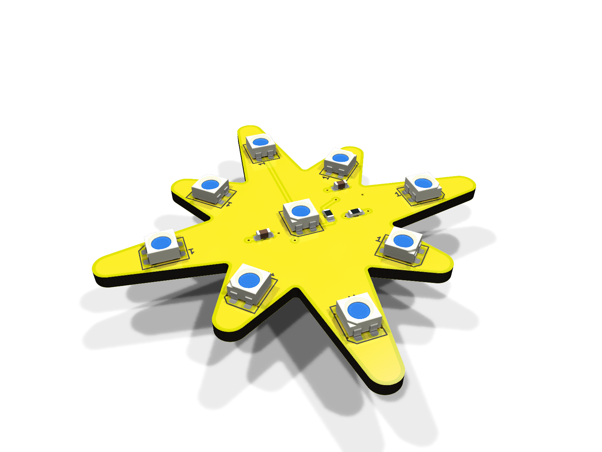
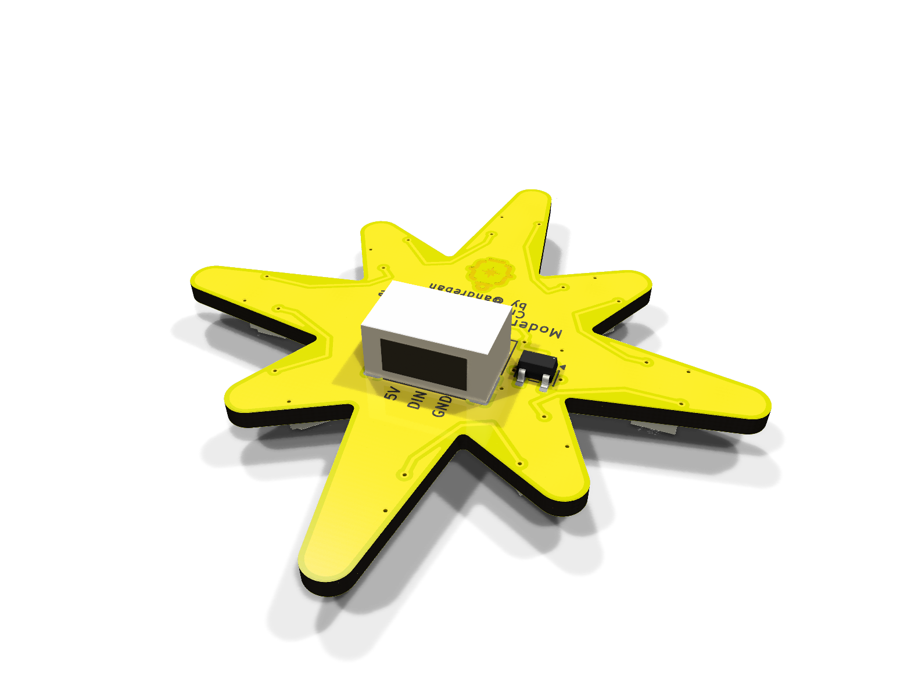

# NeoPixel Star: hot-plate version

An SMD version for home assembly: every part that needs solder paste is on the front, so the front
reflows in one pass on a hot plate. Only the connector and the level-shifter chip are on the back,
soldered afterwards with an iron. 50 mm, 3535 LEDs. For the shared wiring, power and code notes,
see the [main README](../README.md).

| Front | Back |
|---|---|
|  |  |
|  |  |

Schematic: [docs/schematic.pdf](docs/schematic.pdf)

> **Status:** passes KiCad ERC and DRC, including schematic parity. Not manufactured or tested yet.

## How it differs from the SMD board

- **LEDs:** 9 × Worldsemi **WS2812B-MINI-V3/W** (3535). Same pinout and protocol as the 5050
  WS2812B. They are smaller, so they sit further out into the points (17 mm and 13 mm from the
  centre, versus 13.4 mm and 10.4 mm).
- **No per-LED capacitors:** the datasheet calls for none. There is one 10 µF bulk capacitor, plus
  100 nF for the level shifter.
- **0603 passives** (1.6 × 0.8 mm), easier to place by hand than 0402.
- **Level shifter kept:** these LEDs need 0.63 × VDD (3.15 V) on DIN, which 3.3 V logic only just
  meets. U1 makes it reliable.
- **Front silkscreen:** LED outlines with a pin-1 mark, to place them by hand. The SMD board's front
  is blank.

## Parts

| Ref | Side | Part | LCSC |
|---|---|---|---|
| LED1–LED9 | front | Worldsemi WS2812B-MINI-V3/W, 3535 | C527089 |
| C1 | front | 10 µF 0603 X5R (Samsung CL10A106KP8NNNC) | C19702 |
| C2 | front | 100 nF 0603 X7R (YAGEO CC0603KRX7R9BB104) | C14663 |
| R1 | front | 330 Ω 0603 (UNI-ROYAL 0603WAF3300T5E) | C23138 |
| R2 | front | 100 kΩ 0603 (UNI-ROYAL 0603WAF1003T5E) | C25803 |
| U1 | back | TI SN74AHCT1G125DBVR, SOT-23-5 | C7484 |
| J1 | back | JST S3B-PH-SM4-TB(LF)(SN) | C265101 |

## Assembly

1. **Bake the LEDs first.** They are moisture-sensitive (MSL 5a): 120 °C for 4 hours for loose
   parts (or 70–75 °C for 24 hours), then solder them within 24 hours.
2. **Front, on the hot plate.** Order a solder-paste stencil with the boards (front side only).
   Paste the front, then place R1, R2, C1, C2 and the 9 LEDs. Each LED's pin-1 corner matches the
   `1` on its silkscreen outline. Reflow with the back of the board flat on the plate. Aim for a
   245 °C peak and don't linger: about 45–90 s above 217 °C.
3. **Back, with an iron.** Solder U1 (pin 1 at the triangle) and J1 (opening toward the top point).
4. Before powering it up, check with a multimeter that 5V and GND aren't shorted.

## Ordering

`fab/neopixel-star-hotplate-gerbers.zip`, with the board options from the
[main README](../README.md#ordering). Add a **stencil for the front (top) layer**. `fab/jlcpcb/`
and `fab/pcbway/` also have BOM and placement files if you'd rather have it assembled.
