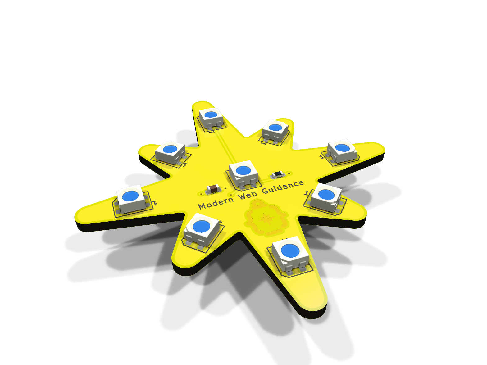
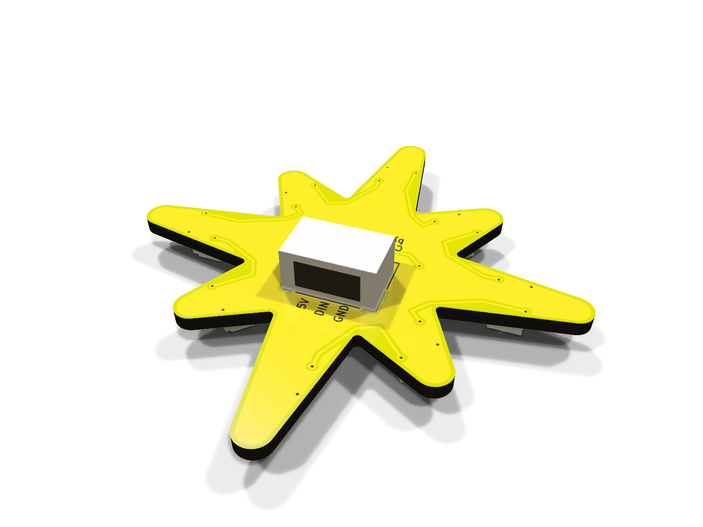

# NeoPixel Star: hot-plate versions

SMD designs for home assembly on a hot plate: every part that needs solder paste sits on the front
so the front reflows in a single pass with the back flat on the plate. 50 mm tip to tip, 3535 LEDs,
0603 passives.

| | [v1](v1/README.md) | [v2](v2/README.md) |
|---|---|---|
| Front |  |  |
| Back |  |  |
| **LEDs** | Worldsemi **WS2812B-MINI-V3/W** (`C527089`) | Worldsemi **WS2812B-MINI-V6** (`C52941386`) |
| **Data input ($V_{IH}$)** | $0.63 \times V_{DD}$ ($3.15\text{ V}$ at $5\text{ V}$) → uses `U1` (`74AHCT1G125`) level shifter | $0.55 \times V_{DD}$ ($2.75\text{ V}$ at $5\text{ V}$) → 3.3 V logic drives `DIN` directly |
| **Front parts (reflow)** | `LED1–LED9`, `C1` (10 µF), `C2` (100 nF), `R1` (330 Ω), `R2` (100 kΩ) | `LED1–LED9`, `C1` (10 µF), `R1` (330 Ω) |
| **Back parts (iron)** | `J1` (JST-PH 3p) + `U1` (SOT-23-5) | `J1` (JST-PH 3p) only |

See [v1/README.md](v1/README.md) or [v2/README.md](v2/README.md) for full parts lists, assembly
steps and ordering notes, and the [main README](../README.md) for wiring and example code.
