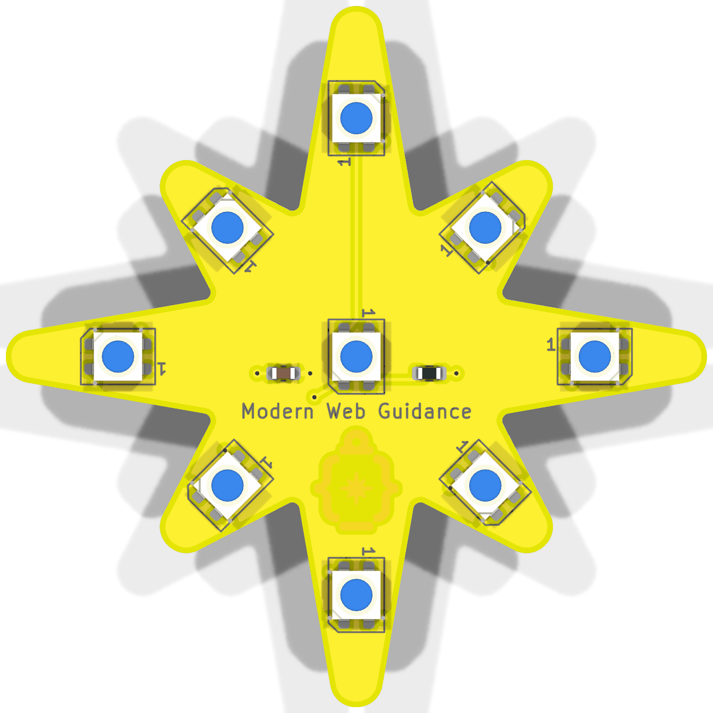
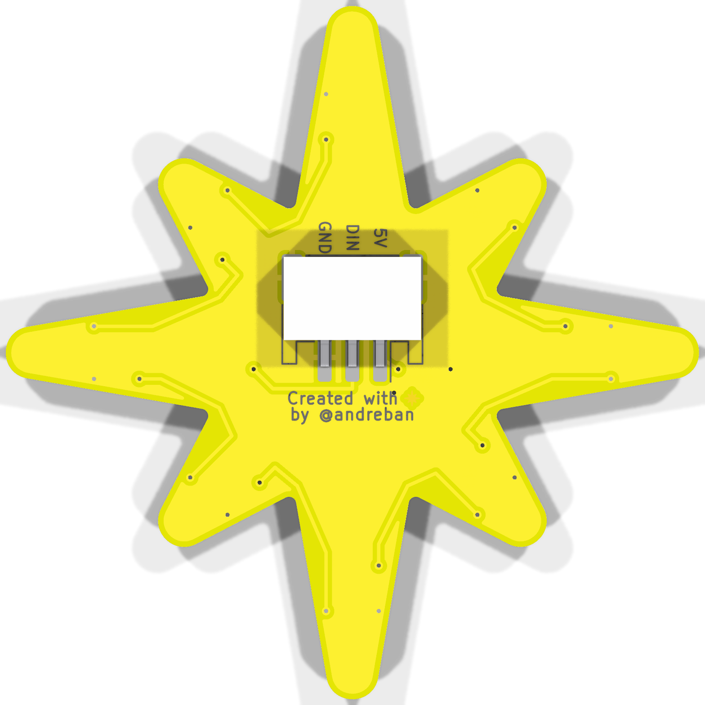
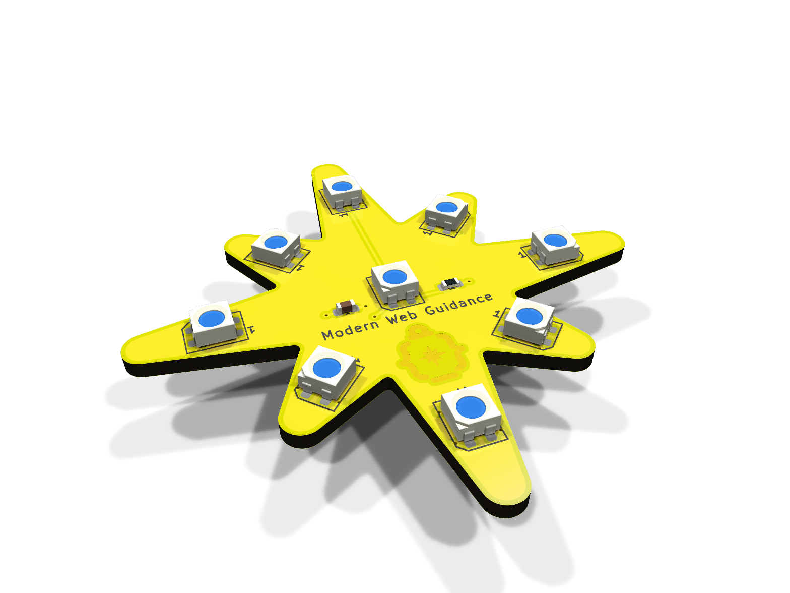
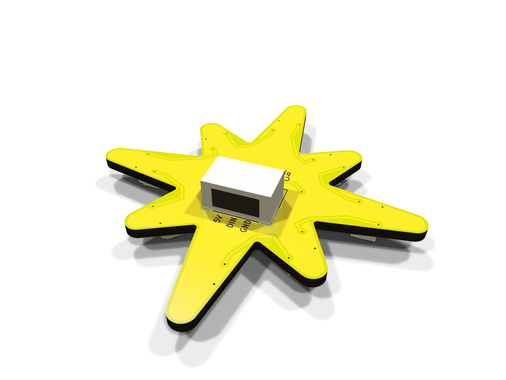

# NeoPixel Star: hot-plate version (v2)

An SMD version for home assembly: every part that needs solder paste is on the front, so the front
reflows in one pass on a hot plate. Only the JST connector is on the back, soldered afterwards with
an iron. 50 mm, 3535 LEDs. For the shared wiring, power and code notes, see the
[main README](../../README.md).

| Front | Back |
|---|---|
|  |  |
|  |  |

Schematic: [docs/schematic.pdf](docs/schematic.pdf)

> **Status:** passes KiCad ERC and DRC, including schematic parity. Not manufactured or tested yet.

## How it differs from the SMD board and [hot-plate v1](../v1/README.md)

- **LEDs:** 9 × Worldsemi **WS2812B-MINI-V6** (3535). Same pinout, footprint and protocol as the
  `WS2812B-MINI-V3/W` in [v1](../v1/README.md), positioned 17 mm and 13 mm from the centre.
- **No level shifter (U1, C2 and R2 dropped):** the V6 datasheet lowers the data input high
  threshold from $0.63 \times V_{DD}$ ($3.15\text{ V}$) to **$0.55 \times V_{DD}$ ($2.75\text{ V}$
  at $5\text{ V}$)**, so 3.3 V microcontrollers drive `DIN` directly with $0.55\text{ V}$ of margin.
  Only the 3-pin JST connector remains on the back—no SOT-23-5 IC to hand-solder.
- **No per-LED capacitors:** there is just one 10 µF 0603 bulk capacitor (`C1`) and one 330 Ω 0603
  series resistor (`R1`) on the front, arranged symmetrically on either side of the centre LED.
- **Artwork on the front:** "Modern Web Guidance" and the gold logo sit below the centre LED. The
  credit line and pin labels stay on the back.
- **Front silkscreen:** LED outlines with a pin-1 mark, plus `C1` and `R1` marks, to place them by
  hand.

## Parts

| Ref | Side | Part | LCSC |
|---|---|---|---|
| LED1–LED9 | front | Worldsemi WS2812B-MINI-V6, 3535 | C52941386 |
| C1 | front | 10 µF 0603 X5R (Samsung CL10A106KP8NNNC) | C19702 |
| R1 | front | 330 Ω 0603 (UNI-ROYAL 0603WAF3300T5E) | C23138 |
| J1 | back | JST S3B-PH-SM4-TB(LF)(SN) | C265101 |

## Assembly

1. **Bake the LEDs first.** They are moisture-sensitive (MSL 5a): 120 °C for 4 hours for loose
   parts (or 70–75 °C for 24 hours), then solder them within 24 hours.
2. **Front, on the hot plate.** Order a solder-paste stencil with the boards (front side only).
   Paste the front, then place R1, C1 and the 9 LEDs. Each LED's pin-1 corner matches the `1` on
   its silkscreen outline. Reflow with the back of the board flat on the plate. Aim for a 245 °C
   peak and don't linger: about 45–90 s above 217 °C.
3. **Back, with an iron.** Solder J1 (opening toward the top point).
4. Before powering it up, check with a multimeter that 5V and GND aren't shorted.

## Ordering

`fab/neopixel-star-hotplate-v2-gerbers.zip`, with the board options from the
[main README](../../README.md#ordering). Add a **stencil for the front (top) layer**. `fab/jlcpcb/`
and `fab/pcbway/` also have BOM and placement files if you'd rather have it assembled.
