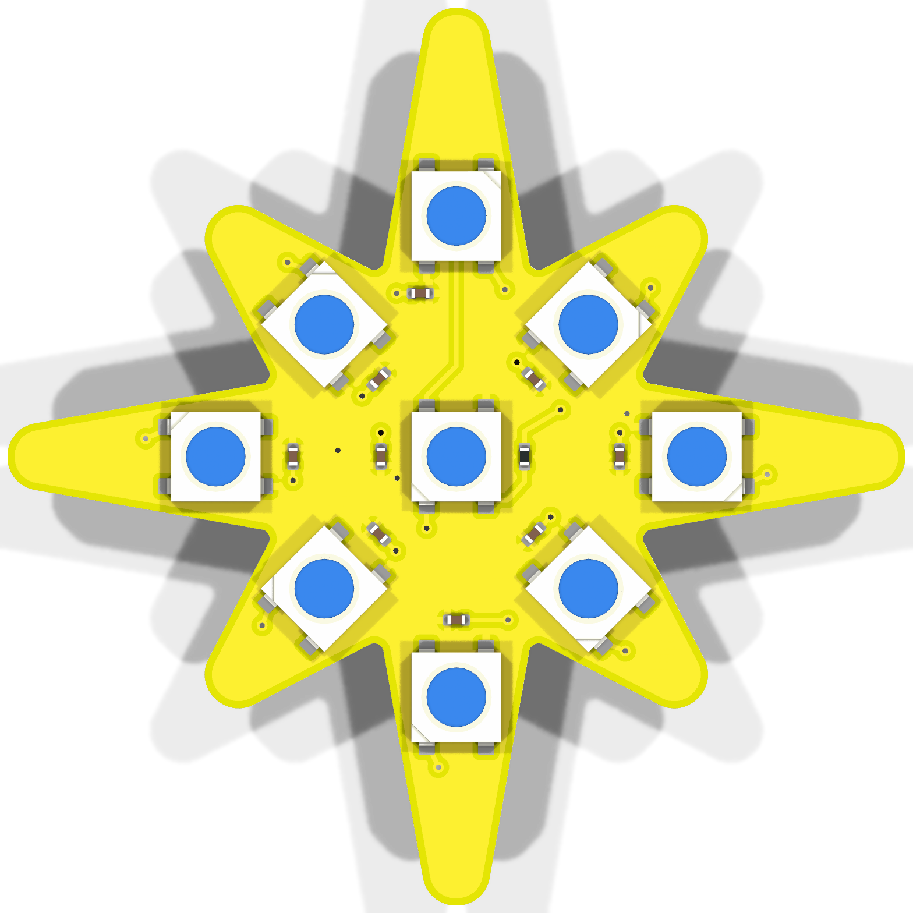
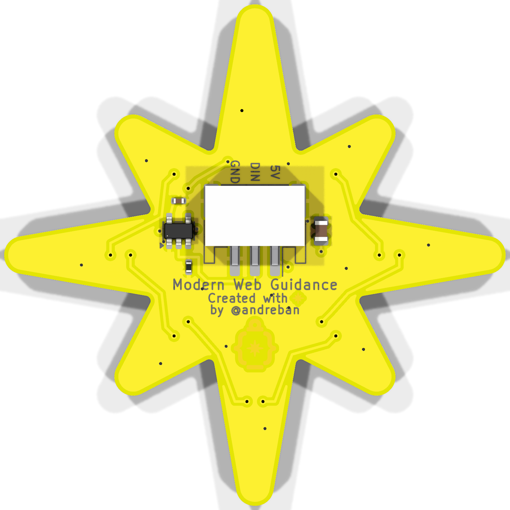
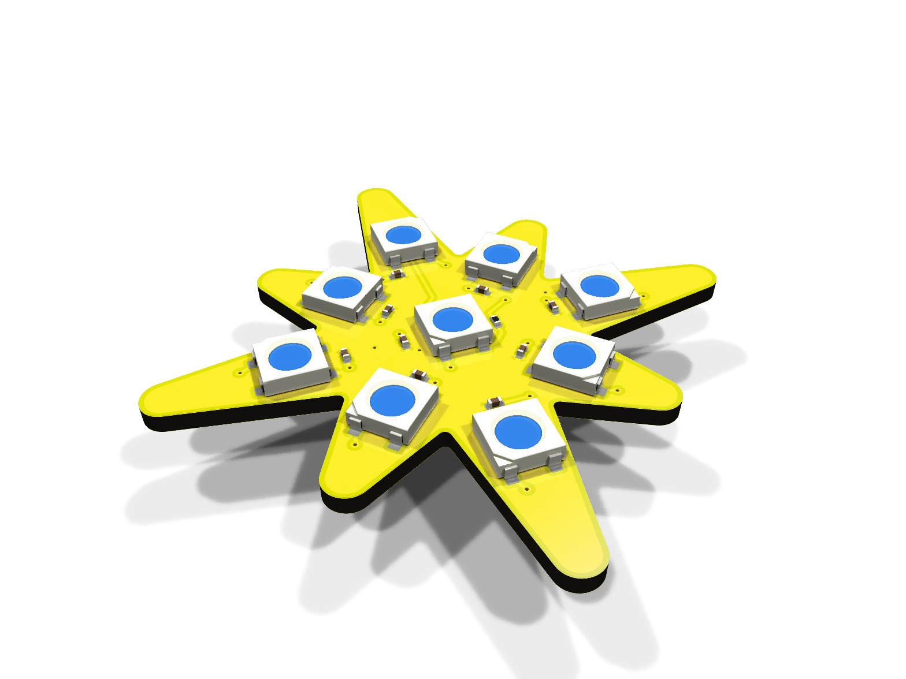
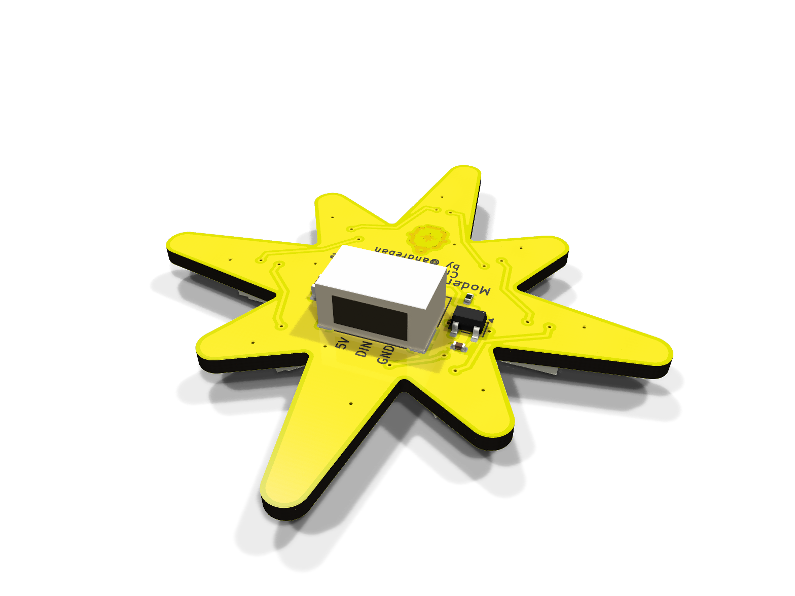
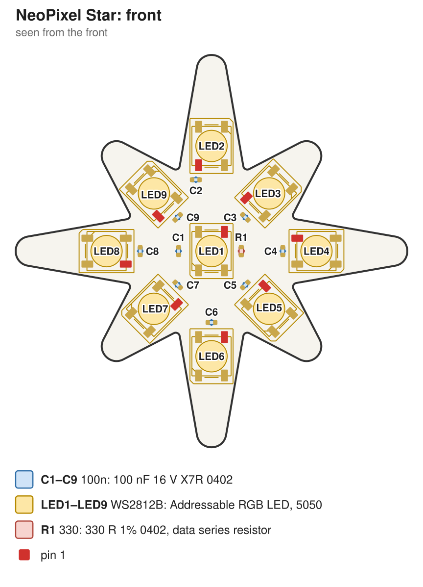
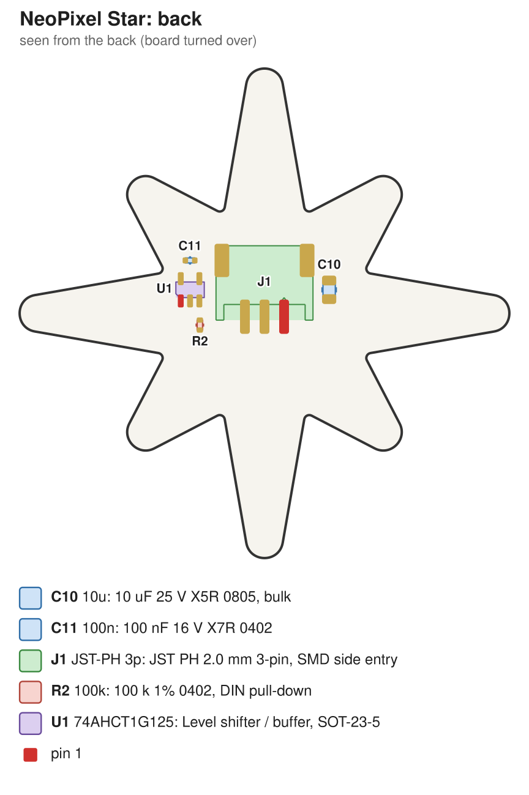

# NeoPixel Star: SMD version

The fab-assembled version: 50 mm, 5050 LEDs, parts on both sides. For the shared wiring, power and
code notes, see the [main README](../README.md).

| Front | Back |
|---|---|
|  |  |
|  |  |
|  |  |

Schematic: [docs/schematic.pdf](docs/schematic.pdf)

Assembly drawing, front and back, for printing: [docs/assembly.pdf](docs/assembly.pdf)

> **Status:** passes KiCad ERC and DRC, including schematic parity. Not manufactured or tested yet.
> Treat the first order as a prototype run.

- 9 × WS2812B (5050): one in the centre, one in each of the 8 points
- 100 nF decoupling cap per LED, 10 µF bulk cap
- On-board **74AHCT1G125 level shifter**, so 3.3 V microcontrollers (Pico, ESP32, …) drive it reliably
- JST-PH 2.0 mm 3-pin SMD connector on the back, cable exits toward the top point
- Front: LEDs, their caps and the 330 Ω data resistor, no silkscreen. Back: connector, level shifter, artwork
- 2 layers, 1.6 mm. Front is a solid 5 V pour, back a solid GND pour

## Ordering

`fab/neopixel-star-gerbers.zip` works at both fabs, with the board options from the
[main README](../README.md#ordering).

### JLCPCB

1. Upload `fab/neopixel-star-gerbers.zip` and choose the board options. If black silkscreen isn't
   offered with yellow mask, white is the fallback. Set *Mark on PCB* to *Remove Mark* (or you get
   an order number printed on the board).
2. PCB Assembly: **both sides**. Upload `fab/jlcpcb/bom.csv` and `fab/jlcpcb/cpl.csv`.
3. **Check part rotations in JLCPCB's placement preview**, especially the LEDs, U1 and J1.
   KiCad's and JLCPCB's zero orientations don't always agree. Fix any that are off in the
   preview. Pin 1 of each LED should match the notched corner in the preview.

### PCBWay

1. Upload `fab/neopixel-star-gerbers.zip` and choose the board options (black silkscreen on yellow mask).
2. For assembly, upload `fab/pcbway/bom.csv` (manufacturer part numbers, LCSC numbers included
   as a cross-reference) and `fab/pcbway/centroid.csv`. Components are on both sides.

## Parts

| Ref | Part | LCSC |
|---|---|---|
| LED1–LED9 | Worldsemi WS2812B-B/T, 5050 | C2761795 |
| C1–C9, C11 | 100 nF 0402 X7R (Samsung CL05B104KO5NNNC) | C1525 |
| C10 | 10 µF 0805 X5R (Samsung CL21A106KAYNNNC) | C15850 |
| R1 | 330 Ω 0402 (UNI-ROYAL 0402WGF3300TCE) | C25104 |
| R2 | 100 kΩ 0402 (UNI-ROYAL 0402WGF1003TCE) | C25741 |
| U1 | TI SN74AHCT1G125DBVR, SOT-23-5 | C7484 |
| J1 | JST S3B-PH-SM4-TB(LF)(SN) | C265101 |

Check stock and prices when ordering. Any WS2812B/SK6812 in the 4-pin 5050 package with the
same pinout works.

## Opening in KiCad or EasyEDA

- **KiCad 10:** open `kicad/neopixel-star.kicad_pro`. KiCad ships no 3D model for the SMD JST
  connector. `kicad/neopixel-star.3dshapes/` has a simple generated one (housing, opening, leads,
  tabs), used for the renders.
- **EasyEDA Pro:** *File → Import → KiCad*, then pick `easyeda/neopixel-star-kicad.zip`. After importing:
  - EasyEDA's default via rule asks for a 0.5 mm hole. This board uses 0.3 mm vias, which both fabs
    make at standard price. Set *Design → Design Rules → Via Size* to a minimum inner diameter of
    0.3 mm and a minimum outer diameter of 0.6 mm.
  - EasyEDA rebuilds the copper pours on import, so check the front 5 V and back GND pours.
  - EasyEDA's DRC may also flag the gold artwork (copper deliberately connected to no net) and
    LED9's unused DOUT pin. Both are expected.
- **Anything else:** `easyeda/outline.dxf` is the exact board outline, and the Gerbers work with any viewer.
