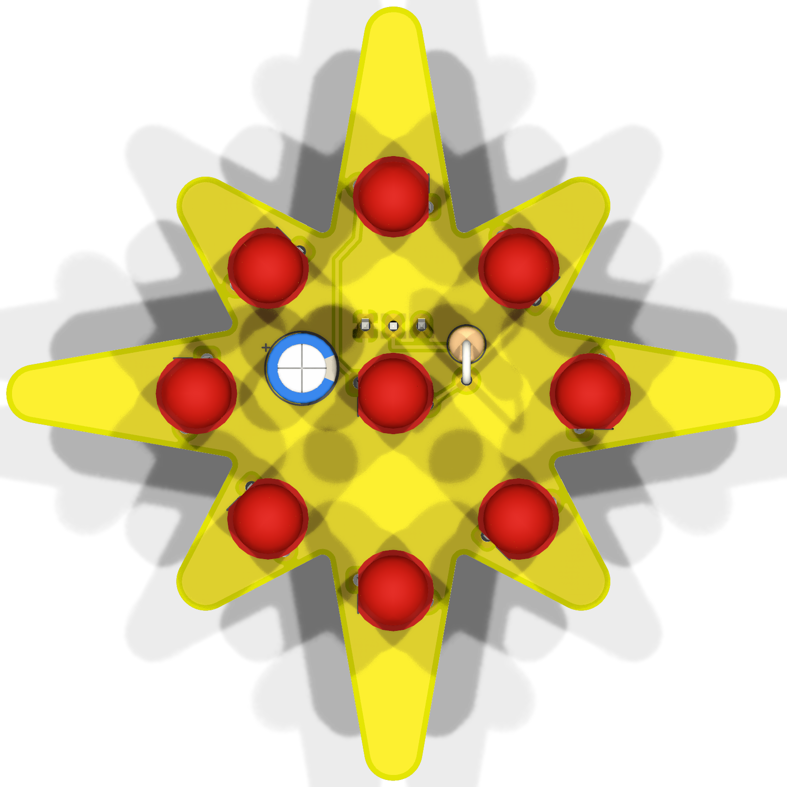
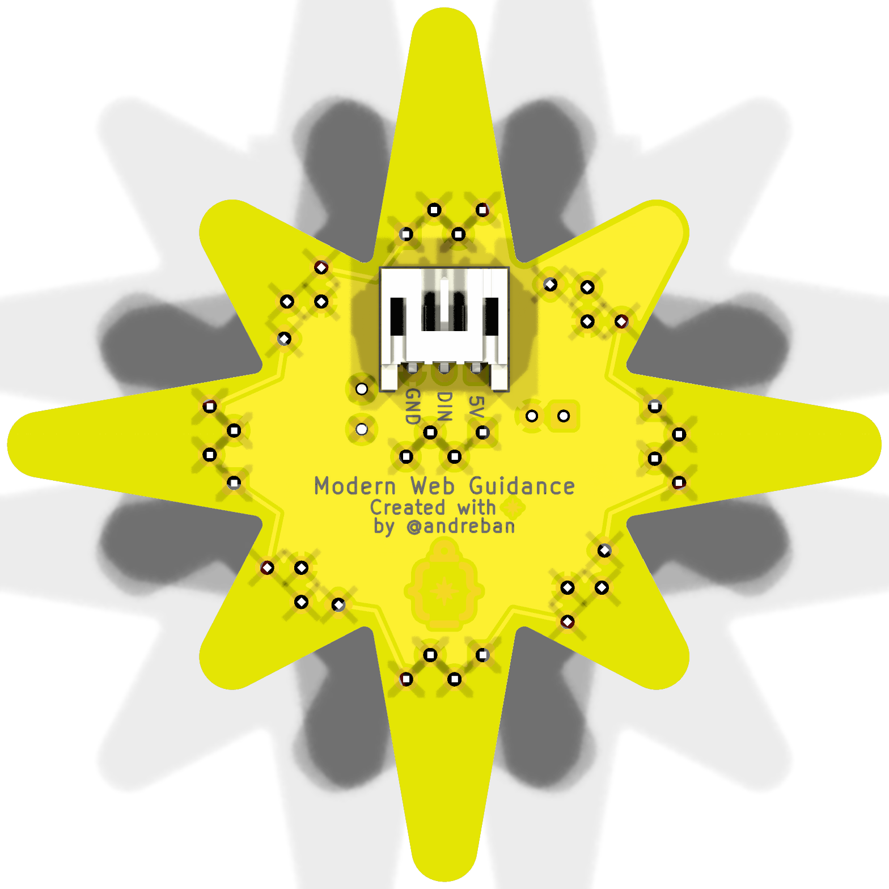
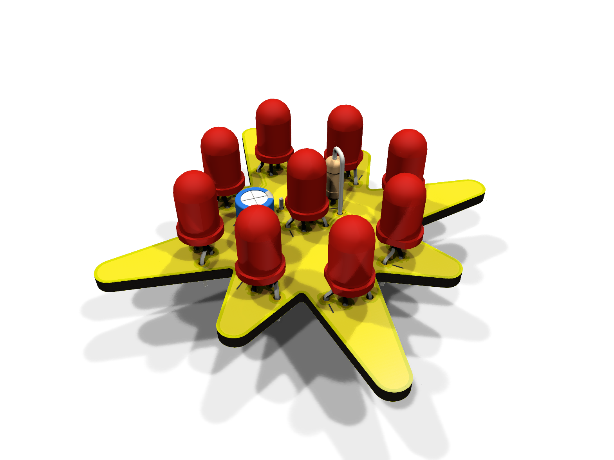
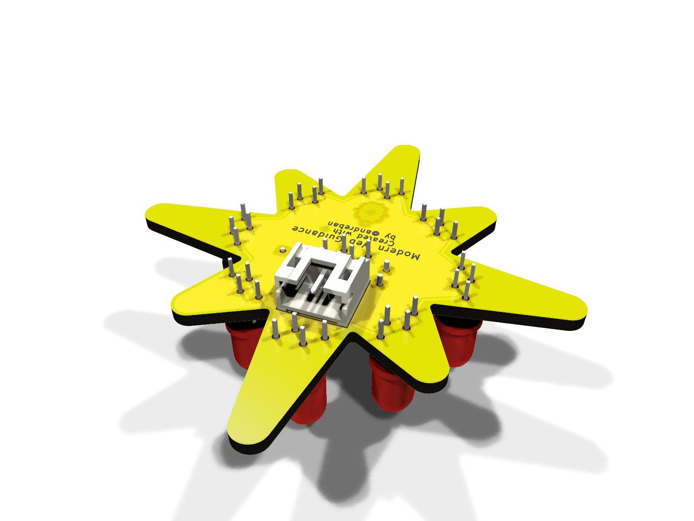
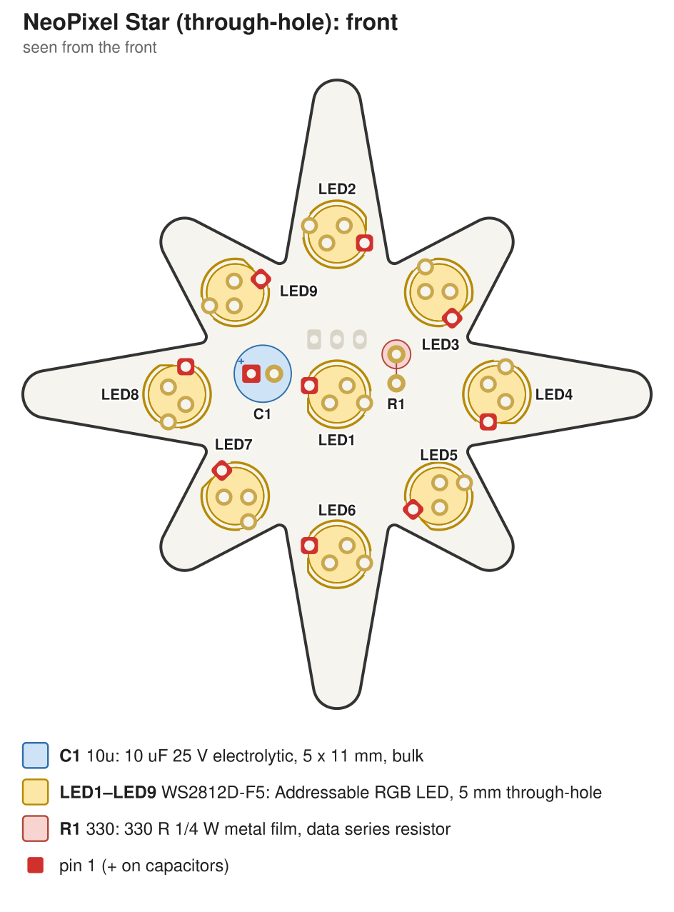
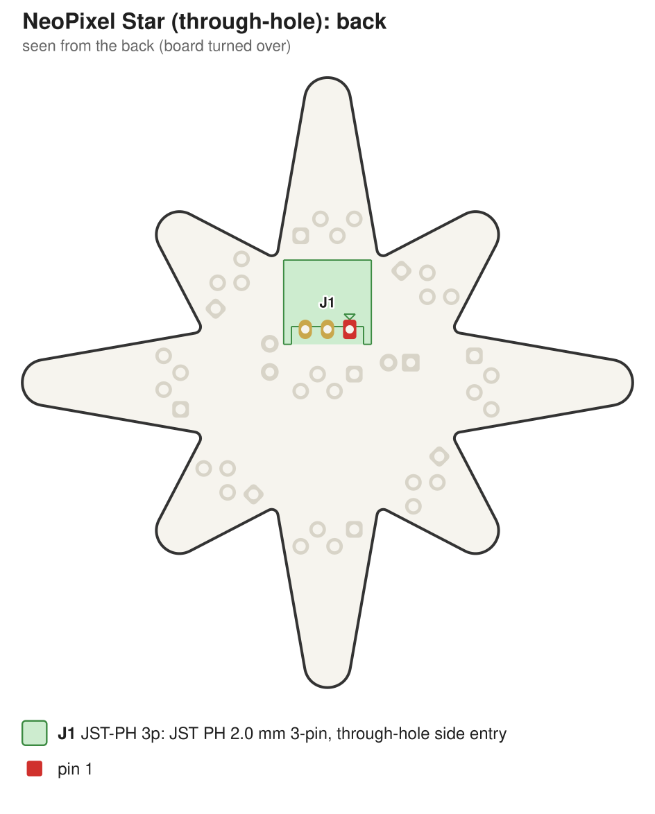

# NeoPixel Star: through-hole version

A hand-solderable version of the [NeoPixel Star](../README.md): the same outline, artwork, wiring and
data order, built from through-hole parts. It is **55 mm** tip to tip (the SMD board is 50 mm).

| Front | Back |
|---|---|
|  |  |
|  |  |
|  |  |

Schematic: [docs/schematic.pdf](docs/schematic.pdf)

Assembly drawing, front and back, for printing: [docs/assembly.pdf](docs/assembly.pdf)

> **Status:** passes KiCad ERC and DRC, including schematic parity. Not manufactured or tested yet.

## How it differs from the SMD board

- **LEDs:** 9 × Worldsemi **WS2812D-F5** (5 mm, 4 leads). Their data input threshold is a fixed
  2.7 V, so **3.3 V microcontrollers drive them directly**. No level shifter, and the LEDs run at a
  full 5 V.
- **No per-LED capacitors:** the WS2812D-F5 datasheet calls for none. There is one 10 µF bulk
  capacitor at the input.
- **Parts on the front, soldered from the back.** The exception is the connector: it sits on the
  back, with the cable exiting toward the top point, and its 3 pins are soldered from the front.
- **Staggered LED footprint.** The WS2812D-F5 leads are 1.27 mm apart. Inline pads at that pitch
  leave too thin a copper ring, so the footprint staggers alternate leads by 1.52 mm: the leads
  zig-zag (see Assembly).
- **Size:** 55 mm, because at 50 mm the LEDs only fit pulled in so far that the top LED's leads end
  up under the connector.
- **Front silkscreen:** each LED has a short line marking where its **flat side** goes (pin 1).
  The electrolytic capacitor's `+` and the outlines of R1 and C1 are also marked.

## Parts

| Ref | Part | LCSC |
|---|---|---|
| LED1–LED9 | Worldsemi WS2812D-F5, 5 mm | C190565 |
| C1 | 10 µF 25 V electrolytic, 5 × 11 mm, 2 mm lead spacing | C43347 |
| R1 | 330 Ω ¼ W metal film, mounted upright | C119313 |
| J1 | JST S3B-PH-K-S (PH, 3-pin, side entry) | C157929 |

Any 5 mm WS2812D-F5-compatible LED works **only if its pinout is 1 DOUT, 2 VDD, 3 GND, 4 DIN**.
Other 5 mm addressable LEDs order their leads differently: some swap VDD and GND (APA106, a short
across the supply), others swap the data pins (the chain doesn't light).

## Assembly

1. **R1 and C1 first.** C1's longer lead (`+`) goes in the square pad.
2. **LEDs:** bend the leads into a zig-zag just below the body: pins 1 and 3 about 0.8 mm one
   way, pins 2 and 4 about 0.8 mm the other way. Insert with the LED's flat side over the short
   silkscreen line (pin 1), seat it level, and solder from the back.
3. **J1 last:** it goes on the **back**, with its opening facing the top point. Solder its 3 pins
   from the front.
4. Before powering it up, check with a multimeter that 5V and GND aren't shorted.

Wiring and power are the same as the SMD board: 5V / DIN / GND on J1 (labelled on the back),
data order centre first, then clockwise from the top point. See the [main README](../README.md#wiring).

## Ordering

`fab/neopixel-star-tht-gerbers.zip` with the board options from the
[main README](../README.md#ordering). Most through-hole builds are hand-soldered, but
`fab/jlcpcb/` and `fab/pcbway/` have BOM and placement files for through-hole assembly too.
