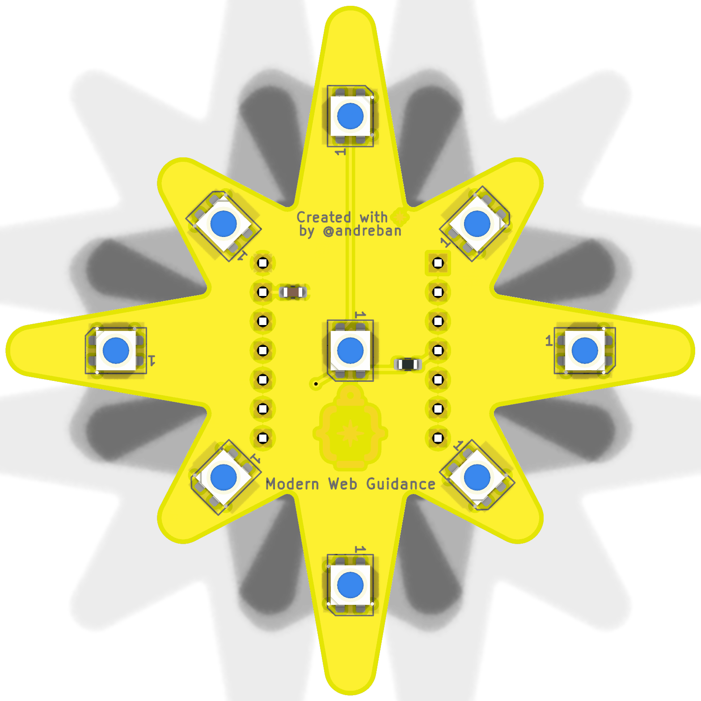
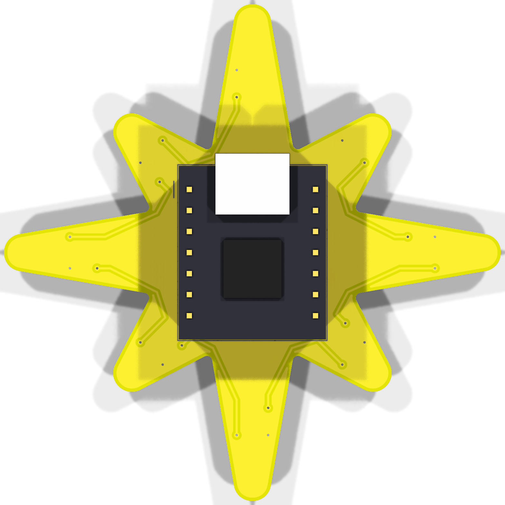
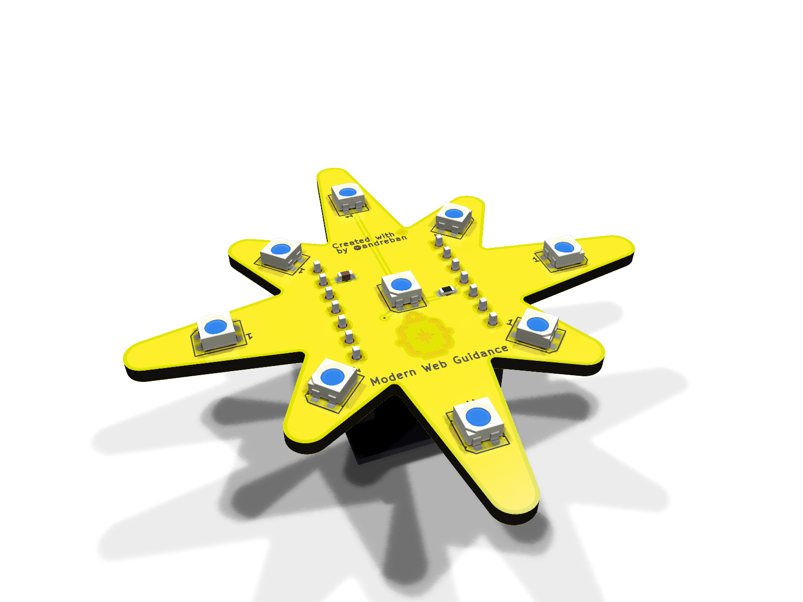
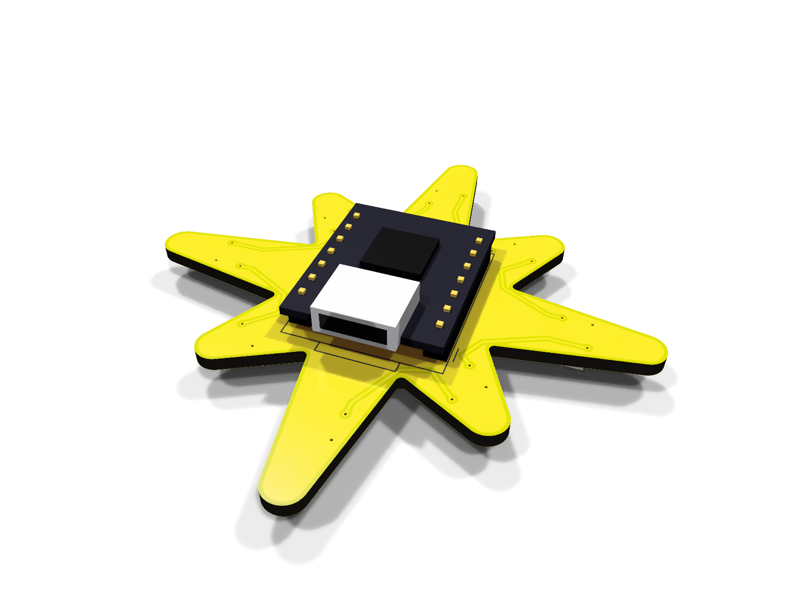
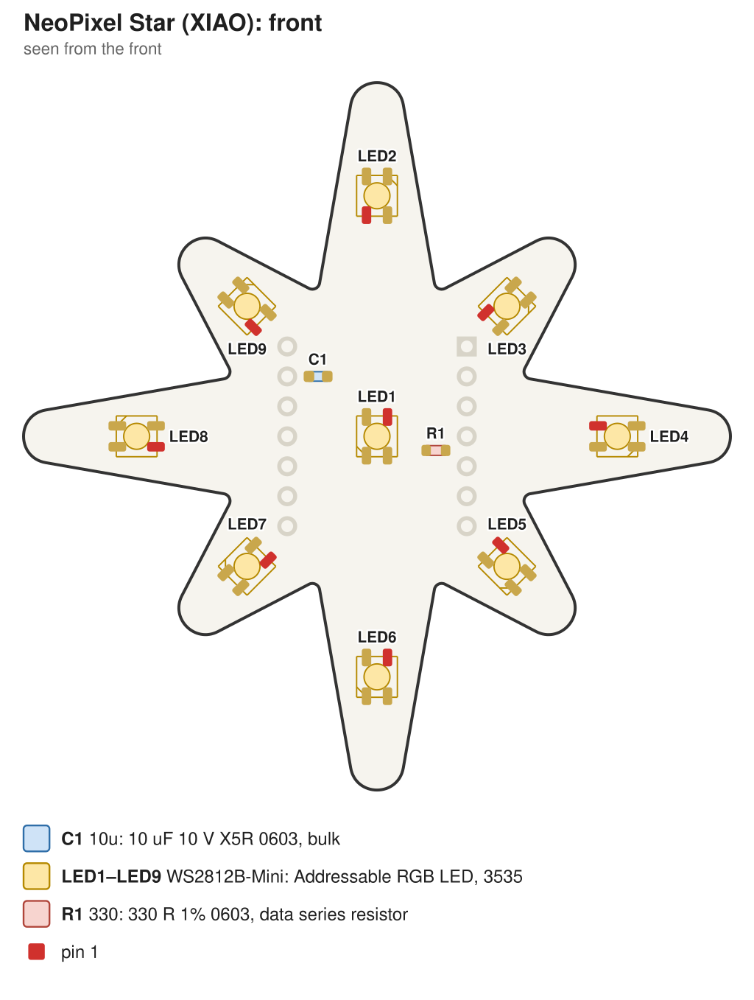
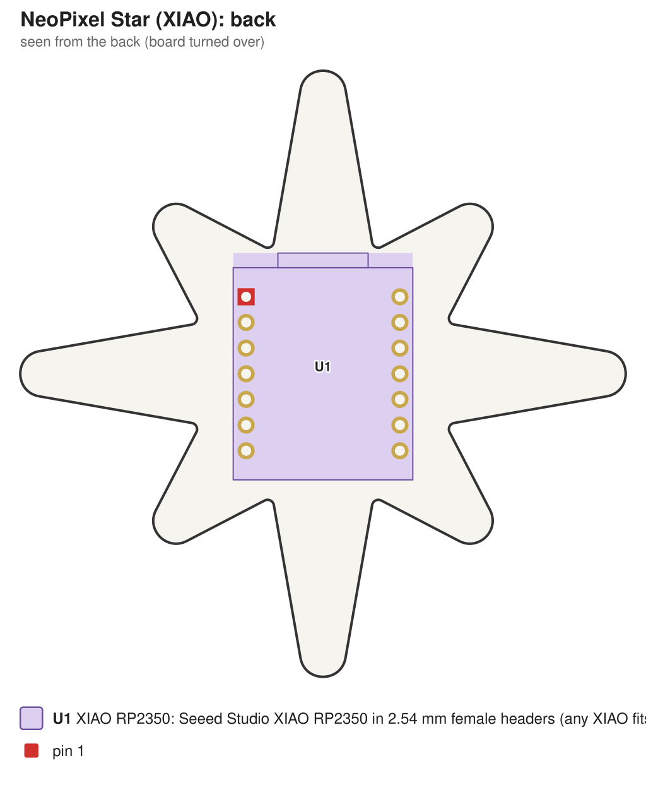

# NeoPixel Star: XIAO version

A self-contained star: a [Seeed Studio XIAO](https://wiki.seeedstudio.com/SeeedStudio_XIAO_Series_Introduction/)
on the back runs the LEDs and connects over its own USB-C. No separate microcontroller, no cable to
wire up. The front is the [hot-plate v2](../hotplate/v2/README.md) design (3535 LEDs that take
3.3 V data directly), so it reflows the same way. The XIAO plugs into two female headers on the
back, so it can come out again (to reuse it, or swap in another model). 60 mm.

| Front | Back |
|---|---|
|  |  |
|  |  |
|  |  |

Schematic: [docs/schematic.pdf](docs/schematic.pdf)

Assembly drawing, front and back, for printing: [docs/assembly.pdf](docs/assembly.pdf)

> **Status:** passes KiCad ERC and DRC, including schematic parity. Not manufactured or tested yet.

## Which XIAO

Any of them. All XIAO boards share the same 14 edge pins (`D0`–`D10`, `3V3`, `GND`, `5V`), and the
board only uses three: `5V`, `GND` and `D3`. The BOM lists the **XIAO RP2040**, which is cheap and
well supported in Arduino, MicroPython and CircuitPython. The XIAO RP2350, ESP32-C3/C6/S3 and
nRF52840 work the same way. The pads some models have underneath aren't used.

## How it differs from hot-plate v2

- **No J1.** Power and data come from the XIAO: its `5V` pin is USB VBUS, and its `D3` drives the
  chain through `R1` (330 Ω). The WS2812B-MINI-V6 switches at $0.55 \times V_{DD}$ ($2.75\text{ V}$
  at $5\text{ V}$), so the XIAO's 3.3 V output drives it directly.
- **60 mm instead of 50 mm.** The XIAO's pin rows are 15.24 mm apart, through the middle of the
  board. The LED ring, its vias and the back-side data hops are v2's, scaled up so they clear the
  pins.
- **In female headers, not flat.** A USB-C plug's moulded grip is about 12.5 × 6.5 mm. Soldered
  flat, the plug would hit the board, because the notches between the points are too narrow for it,
  and cutting a slot for it wrecks the logo's shape. The headers lift the module 11 mm (8.5 mm socket
  plus the XIAO's 2.5 mm header plastic), so any plug clears the board. The module's top is about
  14.5 mm above the star's back. Vias are tented, so they can sit under the module.
- **Artwork all on the front.** The module covers the back. The credit line sits above the pin rows,
  the gold logo between them, and the title (0.9 mm instead of 1 mm, to fit) below them.

## Parts

| Ref | Side | Part | LCSC |
|---|---|---|---|
| LED1–LED9 | front | Worldsemi WS2812B-MINI-V6, 3535 | C52941386 |
| C1 | front | 10 µF 0603 X5R (Samsung CL10A106KP8NNNC) | C19702 |
| R1 | front | 330 Ω 0603 (UNI-ROYAL 0603WAF3300T5E) | C23138 |
| U1 | back | Seeed Studio XIAO RP2040 (102010428), or any XIAO | C22184628 |
| — | back | 2 × 1x7 female header, 2.54 mm, 8.5 mm tall (HCTL PM254-1-07-Z-8.5) | C2897370 |
| — | on the XIAO | 2 × 1x7 male pin header, 2.54 mm, 2.5 mm plastic (HCTL PZ254-1-07-Z-8.5) | C2894930 |

## Assembly

1. **Bake the LEDs first.** They are moisture-sensitive (MSL 5a): 120 °C for 4 hours for loose
   parts (or 70–75 °C for 24 hours), then solder them within 24 hours.
2. **Front, on the hot plate.** Order a solder-paste stencil with the boards (front side only).
   Paste the front, then place R1, C1 and the 9 LEDs. Each LED's pin-1 corner matches the `1` on
   its silkscreen outline. Reflow with the back of the board flat on the plate. Aim for a 245 °C
   peak and don't linger: about 45–90 s above 217 °C.
3. **Male headers on the XIAO.** Plug the two male headers into the female ones so they stay
   straight and parallel, then put the XIAO on top, component side up, and solder its 14 pins.
4. **Female headers on the star, with an iron.** Push the female headers' pins through the star
   from the back, with the XIAO still plugged in as a jig and its USB-C toward the top point (the
   outline on the back silkscreen shows where). Solder the 14 pins on the star's front and trim
   them flush.
5. Unplug the XIAO and check with a multimeter that 5V and GND aren't shorted, then plug it back
   in.

## Code

Same data order as the other versions: index 0 is the centre, 1 the top point, then clockwise. Data
is on `D3`. With [Adafruit NeoPixel](https://github.com/adafruit/Adafruit_NeoPixel) in Arduino:

```cpp
#include <Adafruit_NeoPixel.h>

Adafruit_NeoPixel star(9, D3, NEO_GRB + NEO_KHZ800);

void setup() {
  star.begin();
  star.setBrightness(80);  // USB-powered: stay within the port's budget
}

void loop() {
  for (int i = 0; i < 9; i++) {
    star.clear();
    star.setPixelColor(i, star.Color(255, 180, 0));
    star.show();
    delay(200);
  }
}
```

In CircuitPython it's `neopixel.NeoPixel(board.D3, 9)`. In MicroPython on the XIAO RP2040, `D3` is
GPIO29: `neopixel.NeoPixel(machine.Pin(29), 9)`.

**Power:** the LEDs draw from USB through the XIAO's `5V` pin, up to about 540 mA at full white.
That's more than a USB 2.0 port is required to supply, so cap the brightness (above) or with
`FastLED.setMaxPowerInVoltsAndMilliamps(5, 400)`.

## Ordering

`fab/neopixel-star-xiao-gerbers.zip`, with the board options from the
[main README](../README.md#ordering). Add a **stencil for the front (top) layer**. `fab/jlcpcb/` and
`fab/pcbway/` also have BOM and placement files if you'd rather have the front assembled. Leave U1
out of the assembly order and solder it yourself.
